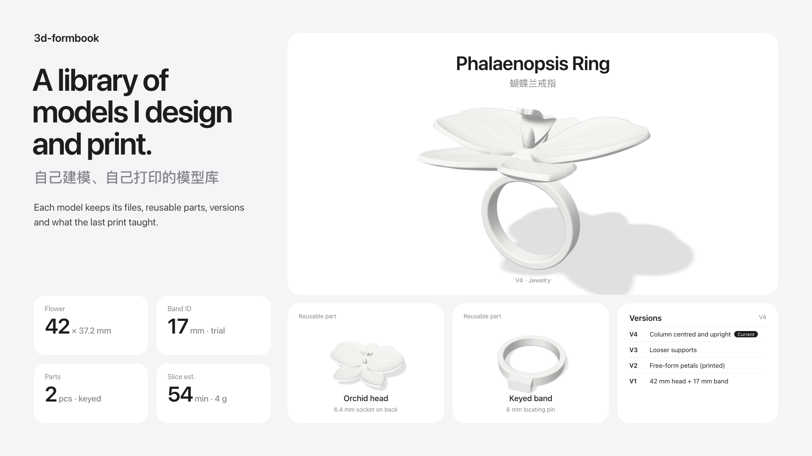
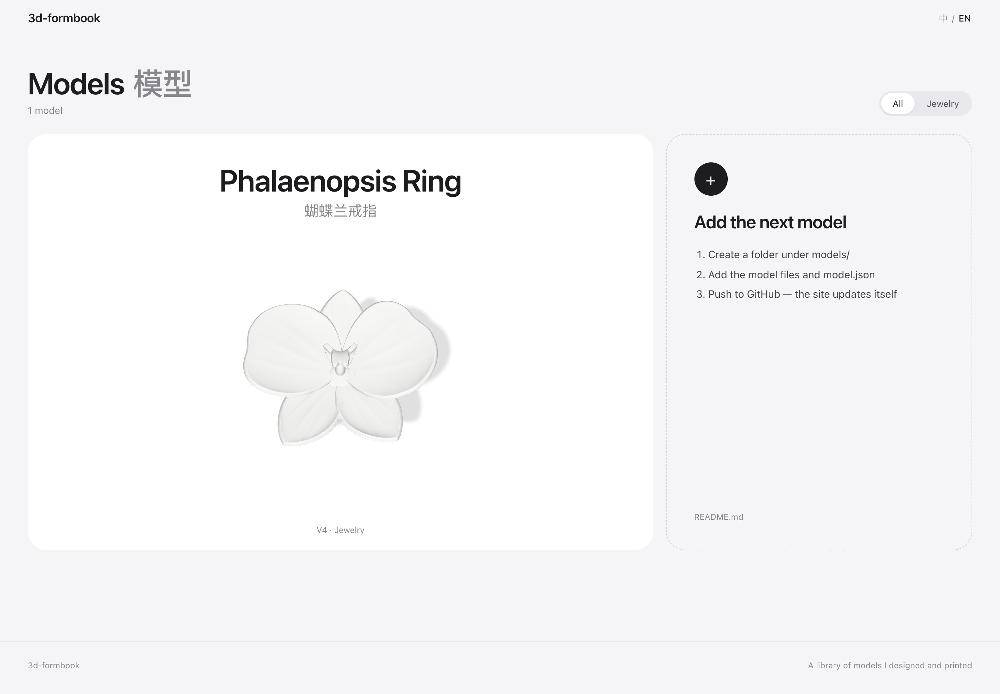
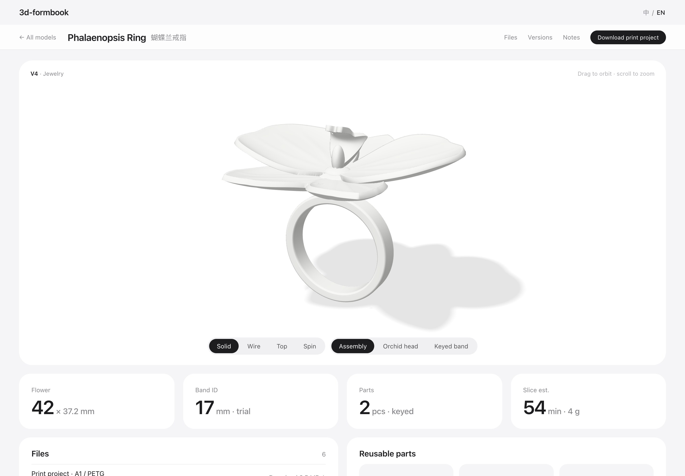
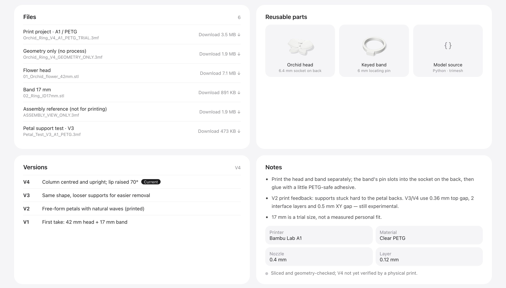
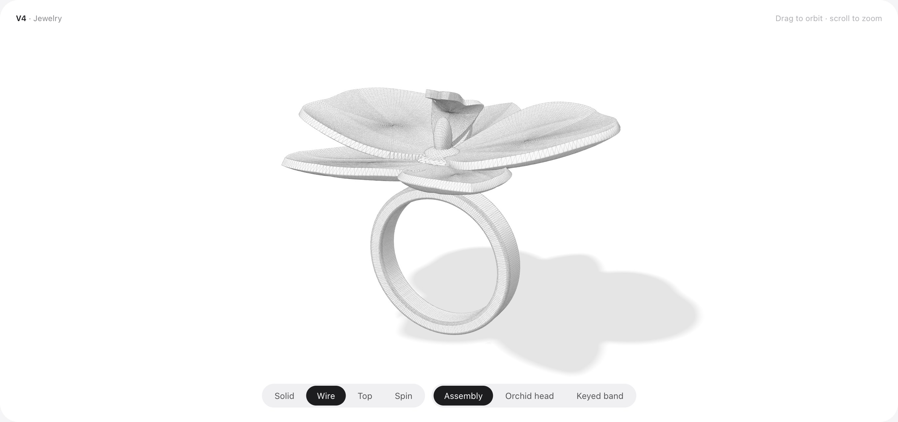

# 3d-formbook

English · [简体中文](README.zh-CN.md)

**A library of the 3D models I design and print. Each model is drawn in your browser from its real STL or 3MF file, next to everything needed to print it again or reuse a part of it: the files, the reusable parts, the versions and what the last print taught me.**

[Open the library →](https://cynthiawongss.com/3d-formbook/)



*Every model in the picture is rendered by the site's own viewer from the files in this repository.*

Print projects tend to end up as loose files in a folder: a flower head here, a slicer project there, and the support settings that finally worked only in your head. 3d-formbook keeps each model as one record, so you can come back months later, find the part you already solved, and start from there.

## Why it looks like this

| Idea | What you see |
| --- | --- |
| The model is the subject | Previews are not photos or screenshots. The viewer reads the actual STL or 3MF file and draws it in a neutral clay grey, so you judge the shape, not a material or a lighting setup. |
| Quiet front page, full record behind it | The library shows only the name and a large render of each model. Sizes, files, versions and notes wait on the model's own page. |
| Built to be reused | Parts that solved a problem once (a flower head with a socket, a band with a locating pin, the modelling script) are listed as **Reusable parts**, each one downloadable on its own. |
| Honest status | Every model says what has and has not been tested, including sizes that are only a first guess. |
| Two languages, side by side | Each title is shown in Chinese and English together. The **中 / EN** switch changes the rest of the site. |



## What each model page holds

| Part | What it gives you |
| --- | --- |
| 3D preview | Drag to orbit, scroll to zoom. **Solid**, **Wire**, **Top** and **Spin** views. For a model with several parts, show the **Assembly** or one part at a time. |
| Specs | A few large numbers, such as size, band size, number of parts and slicing time. |
| **Files** | Every file with its size and a download link. The first one is also the **Download print project** button at the top. |
| **Reusable parts** | Parts and source code worth taking into the next model, each with a small render and a note. |
| **Versions** | What changed from version to version, with the current one marked. |
| **Notes** | Lessons from real prints, plus printer, material, nozzle, layer height and the current print status. |
| **Mesh renders** | Optional extra images. |



## An example: the Phalaenopsis Ring

The first model in the library is a ring made of two printed parts: a 42 mm phalaenopsis flower head and a 17 mm band. A pin on top of the band slots into a 6.4 mm socket on the back of the flower.

| | |
| --- | --- |
| Size | Flower 42 × 37.2 mm, band inner diameter 17 mm (a trial size, not a measured fit) |
| Parts | 2, keyed together and glued |
| Print | Bambu Lab A1, 0.4 mm nozzle, clear PETG, 0.12 mm layers, about 54 minutes and 4 g |
| Versions | V1 first take → V2 free-form petals (printed) → V3 looser supports → **V4** column centred and upright, lip raised 70° |
| Status | Sliced and geometry-checked. V4 has not been verified by a physical print yet. |

The record keeps what the V2 print taught: the supports stuck hard to the backs of the petals, so V3 and V4 use a 0.36 mm top gap, 2 interface layers and a 0.5 mm XY gap. Those values are still experimental. The model itself is written in Python with trimesh and manifold3d, and the script is one of its reusable parts.



**Wire** shows the mesh itself, which helps when checking how a printed surface was built:



## Limits

| Current behaviour | What it means |
| --- | --- |
| Previews read STL and 3MF only | Other files (STEP, source code) can be listed and downloaded, but are not shown in 3D. Add an STL or 3MF for the preview. |
| Clay grey, not the real material | A clear PETG print will be translucent and show layer lines. |
| One model so far | The library is new; the Phalaenopsis Ring is its only entry. |
| Files up to 100 MB each | A GitHub limit. `.gcode` is not committed; share slicer projects as 3MF. |
| Public repository | Anyone can see and download every model file and the modelling source. |

## Add a model

1. Create a folder under `models/`, named in lowercase with dashes, for example `models/snap-box/`.
2. Put model files in `files/`, optional images in `images/`, and optional modelling source in `source/`.
3. Copy [`docs/model.template.json`](docs/model.template.json) into the folder as `model.json` and fill it in. `id` must match the folder name.
4. Push to GitHub. The site rebuilds itself in a minute or two.

```
models/
  snap-box/
    model.json
    files/    snap-box.3mf, snap-box.stl …
    images/   (optional)
    source/   (optional)
```

| Field | Meaning |
| --- | --- |
| `title` | `{ "zh": "中文名", "en": "English name" }` |
| `category` | `jewelry`, `vessel`, `part`, `study` or `other` |
| `preview.file` | The STL or 3MF shown in 3D. A 3MF with several parts gets part buttons automatically. |
| `preview.upAxis` | Usually `"z"` for printer files |
| `preview.card` / `preview.hero` | Starting view on the library card and the model page: `az` turn, `el` height, `fit` distance (larger is farther) |
| `cover` | Optional image used on the library card instead of a live render |
| `specs` | The large numbers at the top of the model page |
| `files` | Downloadable files. The first is the **Download print project** button. |
| `reusable` | Reusable parts and source |
| `versions` / `notes` / `images` / `print` | Version history, notes, extra images and print settings, all optional |

## Run it locally

```bash
node scripts/build-index.mjs
python3 -m http.server 8000
```

Then open http://localhost:8000/. `build-index` writes `models/index.json` and reports any missing `model.json` field or file. There is no other build step.

| Path | What it does |
| --- | --- |
| `index.html`, `assets/js/home.js` | The library page |
| `model.html`, `assets/js/model.js` | The model page |
| `assets/js/render.js` | Loads STL and 3MF files and draws them in clay grey with three.js |
| `assets/js/i18n.js` | Interface text in Chinese and English |
| `scripts/build-index.mjs` | Builds `models/index.json` and checks every model |
| `.github/workflows/pages.yml` | Builds the index and publishes the site to GitHub Pages on every push to `main` |
| `assets/vendor/three/` | three.js (MIT licence) |
