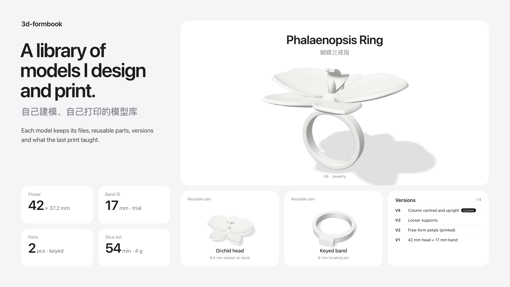
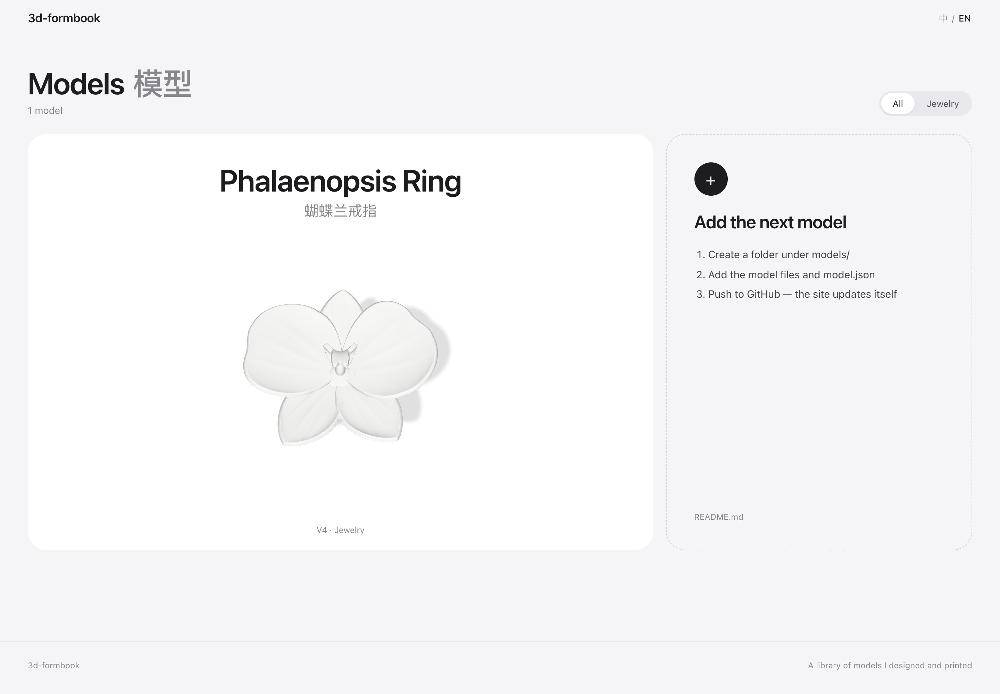
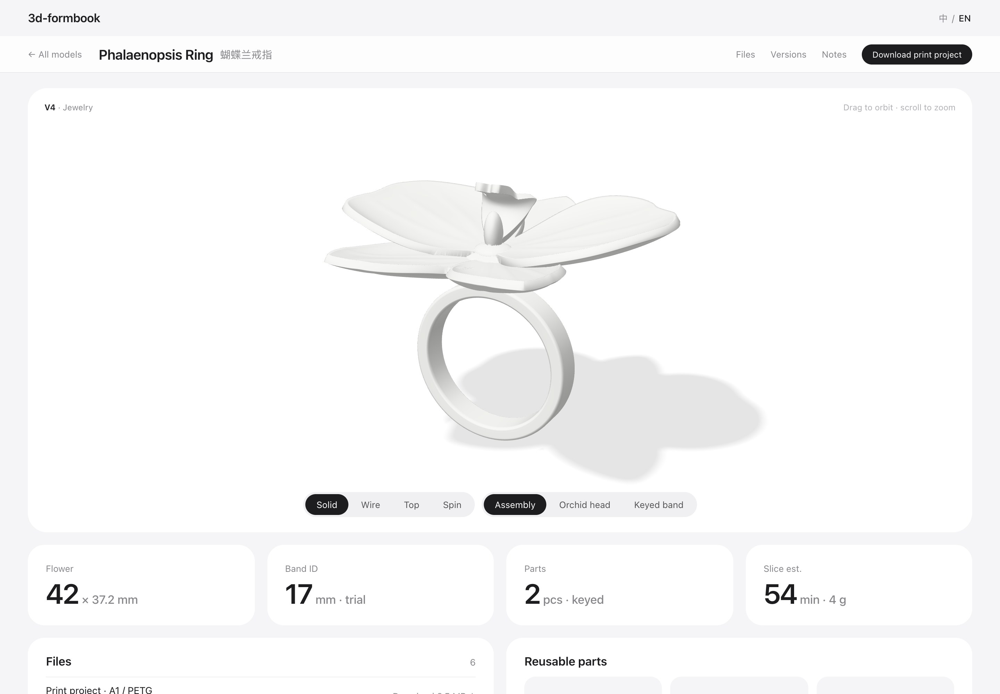
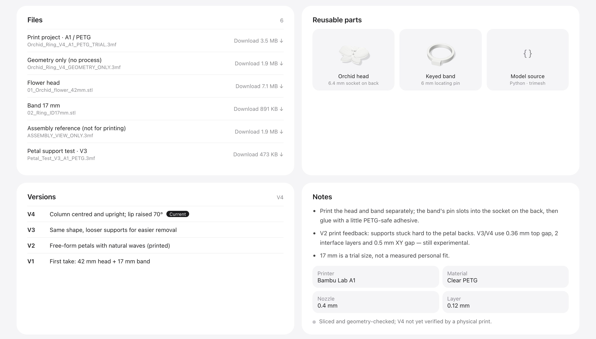
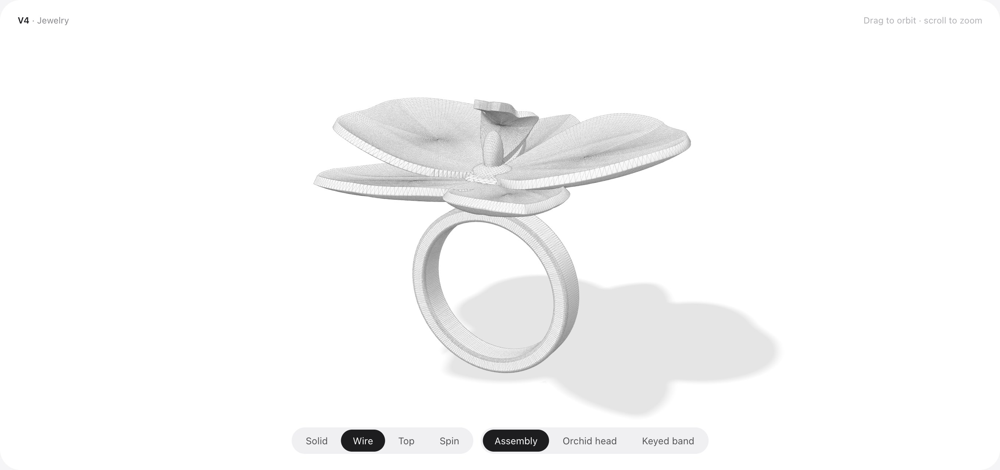

# 3d-formbook

[English](README.md) · 简体中文

**我自己建模、自己打印的 3D 模型库。每个模型都由浏览器直接读取真实的 STL 或 3MF 文件画出来，旁边放着再打一次、或者拿其中一部分去复用所需要的一切：文件、可复用结构、版本，以及上一次打印学到的东西。**

[打开模型库 →](https://cynthiawongss.com/3d-formbook/)



*图里的每个模型，都是用网站自己的预览器、读取这个仓库里的文件渲染出来的。*

打印项目最后常常变成文件夹里零散的文件：这里一个花头，那里一个切片工程，终于调好的支撑参数只记在脑子里。3d-formbook 把每个模型整理成一份完整记录，几个月后回来，也能找到已经解决过的那个结构，从那里接着做。

## 为什么是这个样子

| 想法 | 你看到的 |
| --- | --- |
| 模型是主角 | 预览不是照片，也不是截图。预览器直接读取真实的 STL 或 3MF 文件，用中性的灰白色画出来，让你看的是形状，而不是材质或打光。 |
| 首页安静，记录完整 | 模型库首页只放名字和一张大大的模型图。尺寸、文件、版本、笔记都放在模型自己的页面里。 |
| 为复用而做 | 曾经解决过问题的部分（带插槽的花头、带定位榫的戒圈、建模脚本）单独列在 **可复用结构** 里，每一件都能单独下载。 |
| 如实写状态 | 每个模型都写清楚哪些测试过、哪些没有，包括只是先试一试的尺寸。 |
| 中英文并排 | 每个标题都同时显示中文和英文。右上角 **中 / EN** 切换网站其余部分的语言。 |



## 每个模型页面里有什么

| 部分 | 内容 |
| --- | --- |
| 3D 预览 | 拖动旋转，滚轮缩放。可以切换 **实体**、**线框**、**俯视**、**旋转**。有多个零件的模型，可以看 **组装** 好的整体，也可以一次只看一个零件。 |
| 数字卡片 | 几个大号数字，比如尺寸、戒圈内径、零件数、切片时间。 |
| **文件** | 每个文件的大小和下载链接。第一个文件同时是页面上方的 **下载打印工程** 按钮。 |
| **可复用结构** | 值得带进下一个模型的零件和源码，每一件都有小图和说明。 |
| **版本** | 每个版本改了什么，并标出当前版本。 |
| **笔记** | 实际打印的经验，以及打印机、材料、喷嘴、层高和当前的打印状态。 |
| **网格预览图** | 可选的补充图片。 |



## 一个例子：蝴蝶兰戒指

模型库里的第一个模型，是一枚由两个打印件组成的戒指：一个 42 mm 的蝴蝶兰花头和一个 17 mm 的戒圈。戒圈顶部的榫插进花头背面 6.4 mm 的插槽里。

| | |
| --- | --- |
| 尺寸 | 花头 42 × 37.2 mm，戒圈内径 17 mm（试戴尺寸，不是量过的个人尺寸） |
| 零件 | 2 件，插接后用胶固定 |
| 打印 | Bambu Lab A1，0.4 mm 喷嘴，透明 PETG，0.12 mm 层高，约 54 分钟、4 g |
| 版本 | V1 初版 → V2 自由曲线花瓣（已实际打印）→ V3 放松支撑 → **V4** 花心居中、沿花面立起，唇瓣上收 70° |
| 状态 | 已切片、几何检查通过。V4 还没有经过实物打印验证。 |

记录里保留了 V2 打印学到的东西：花瓣背面的支撑粘得很牢，所以 V3 和 V4 改用 0.36 mm 顶部间隙、2 层接触层、0.5 mm XY 间隙。这些数值仍然是试验值。模型本身是用 Python 和 trimesh、manifold3d 写出来的，建模脚本也是它的可复用结构之一。



**线框** 会显示网格本身，检查打印表面是怎么构成的时候很有用：



*截图是网站的英文界面；切换到"中"之后，所有按钮和标题都会显示中文。*

## 限制

| 当前行为 | 意味着什么 |
| --- | --- |
| 预览只读取 STL 和 3MF | 其他文件（STEP、源码）可以列出来、可以下载，但不会显示成 3D。需要预览时请另外放一份 STL 或 3MF。 |
| 灰白色，不是真实材质 | 透明 PETG 打印出来会透光，也会有层纹。 |
| 目前只有一个模型 | 模型库刚开始，蝴蝶兰戒指是唯一的一件。 |
| 单个文件不超过 100 MB | GitHub 的限制。`.gcode` 不提交，切片工程请用 3MF。 |
| 仓库是公开的 | 任何人都能看到并下载所有模型文件和建模源码。 |

## 添加一个模型

1. 在 `models/` 下新建一个文件夹，名字用英文小写和短横线，例如 `models/snap-box/`。
2. 把模型文件放进 `files/`，图片（可选）放进 `images/`，建模源码（可选）放进 `source/`。
3. 复制 [`docs/model.template.json`](docs/model.template.json) 到这个文件夹，改名为 `model.json` 并填好。`id` 必须和文件夹名一样。
4. 推送到 GitHub。网站会在一两分钟内自动更新。

```
models/
  snap-box/
    model.json
    files/    snap-box.3mf, snap-box.stl …
    images/   (optional)
    source/   (optional)
```

| 字段 | 说明 |
| --- | --- |
| `title` | `{ "zh": "中文名", "en": "English name" }` |
| `category` | `jewelry` 首饰、`vessel` 器物、`part` 结构件、`study` 练习、`other` 其他 |
| `preview.file` | 用来显示 3D 预览的 STL 或 3MF。有多个零件的 3MF 会自动出现零件按钮。 |
| `preview.upAxis` | 打印文件一般是 `"z"` |
| `preview.card` / `preview.hero` | 首页卡片和模型页面的初始视角：`az` 水平角，`el` 俯仰角，`fit` 远近（越大越远） |
| `cover` | 可选，首页卡片改用这张图片，而不是实时渲染 |
| `specs` | 模型页面上方的大号数字 |
| `files` | 可下载的文件。第一个是 **下载打印工程** 按钮。 |
| `reusable` | 可复用结构和源码 |
| `versions` / `notes` / `images` / `print` | 版本记录、笔记、补充图片和打印参数，都可以省略 |

## 本地运行

```bash
node scripts/build-index.mjs
python3 -m http.server 8000
```

然后打开 http://localhost:8000/。`build-index` 会生成 `models/index.json`，并报告缺少的 `model.json` 字段或文件。除此之外不需要构建。

| 路径 | 作用 |
| --- | --- |
| `index.html`、`assets/js/home.js` | 模型库首页 |
| `model.html`、`assets/js/model.js` | 模型页面 |
| `assets/js/render.js` | 读取 STL 和 3MF 文件，用 three.js 画成灰白色模型 |
| `assets/js/i18n.js` | 中英文界面文字 |
| `scripts/build-index.mjs` | 生成 `models/index.json` 并检查每个模型 |
| `.github/workflows/pages.yml` | 每次推送到 `main` 时生成索引，并发布到 GitHub Pages |
| `assets/vendor/three/` | three.js（MIT 许可证） |
